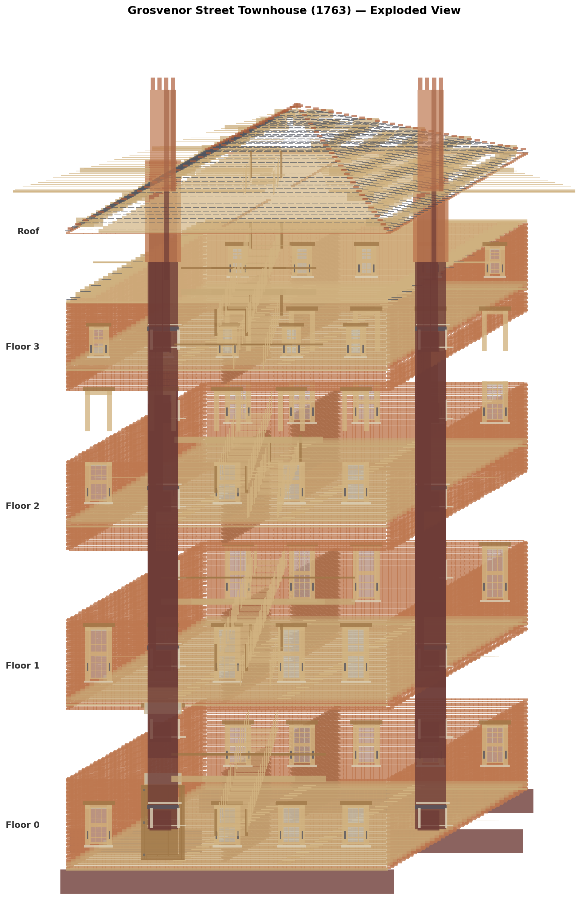
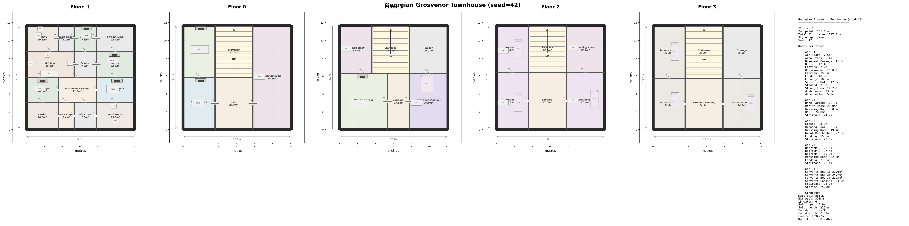
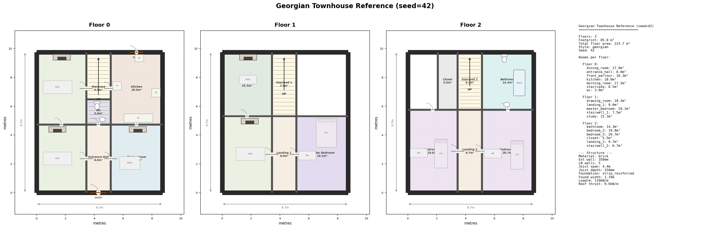
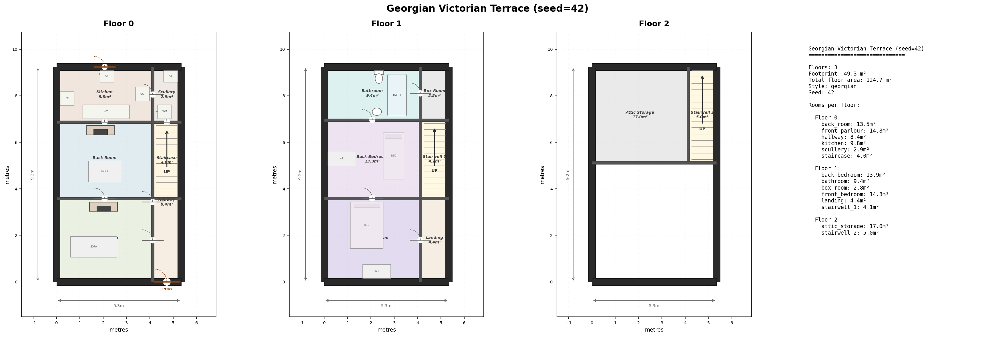
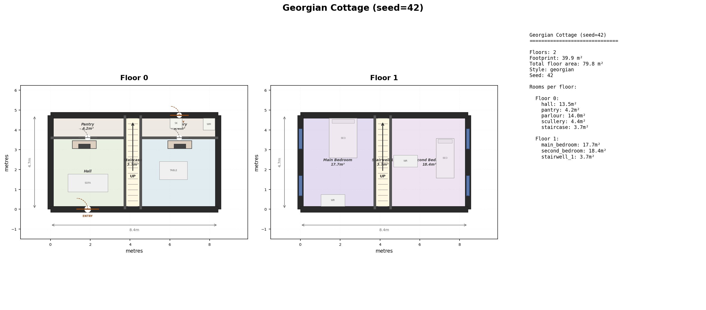
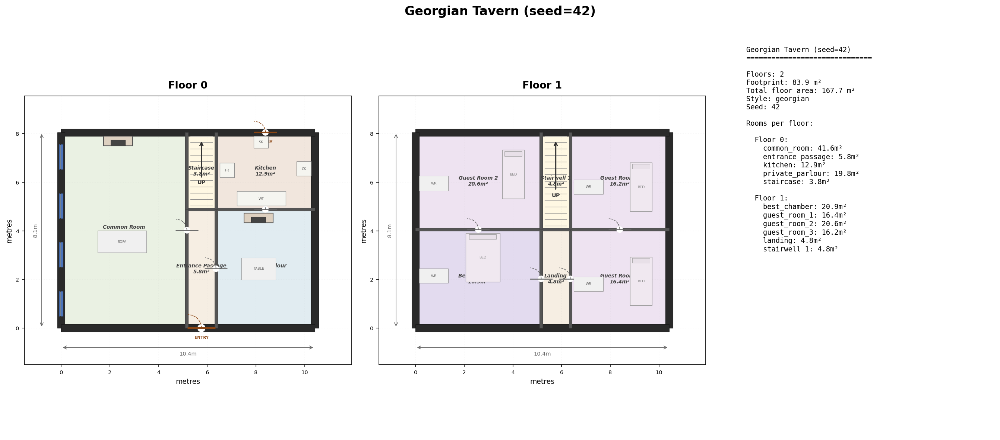
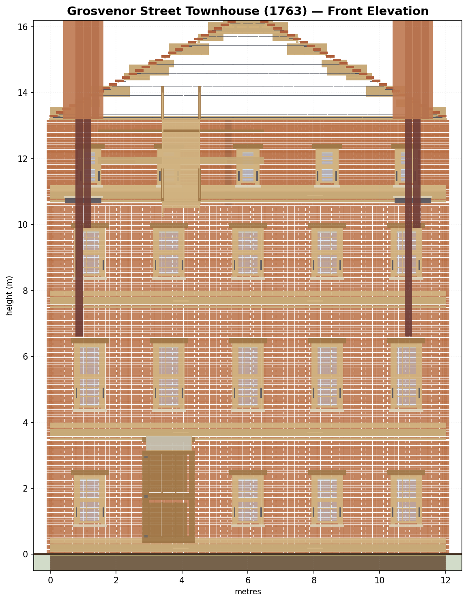
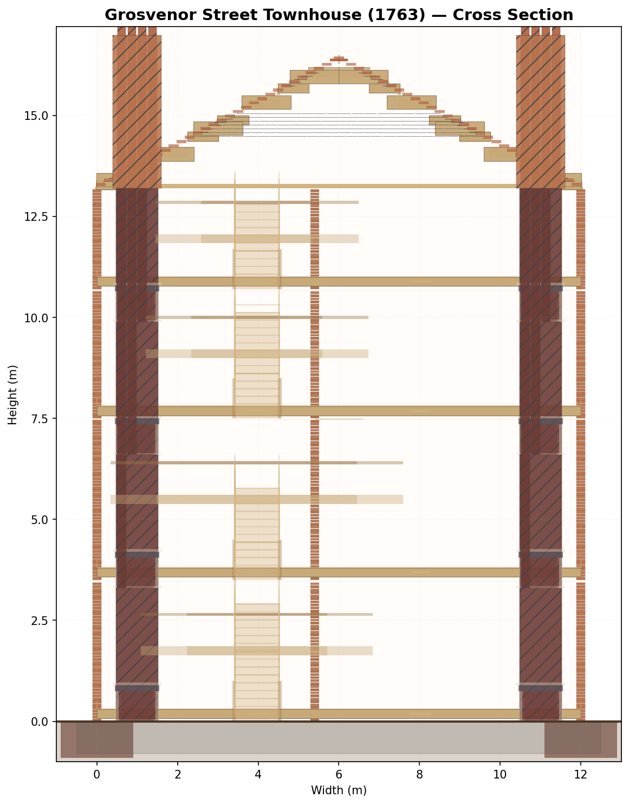
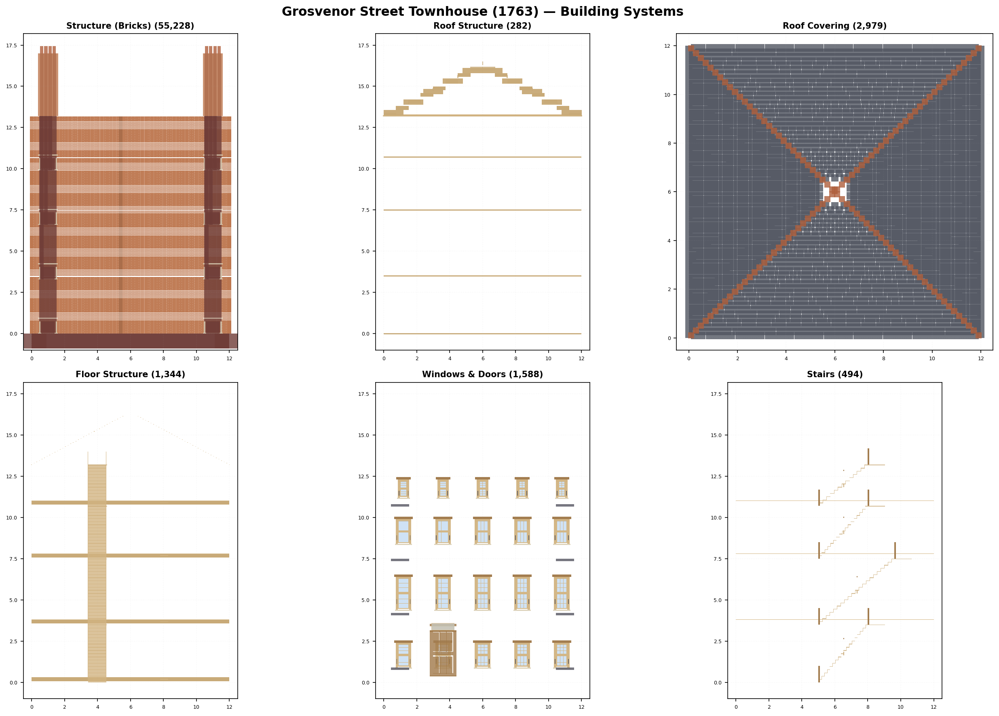
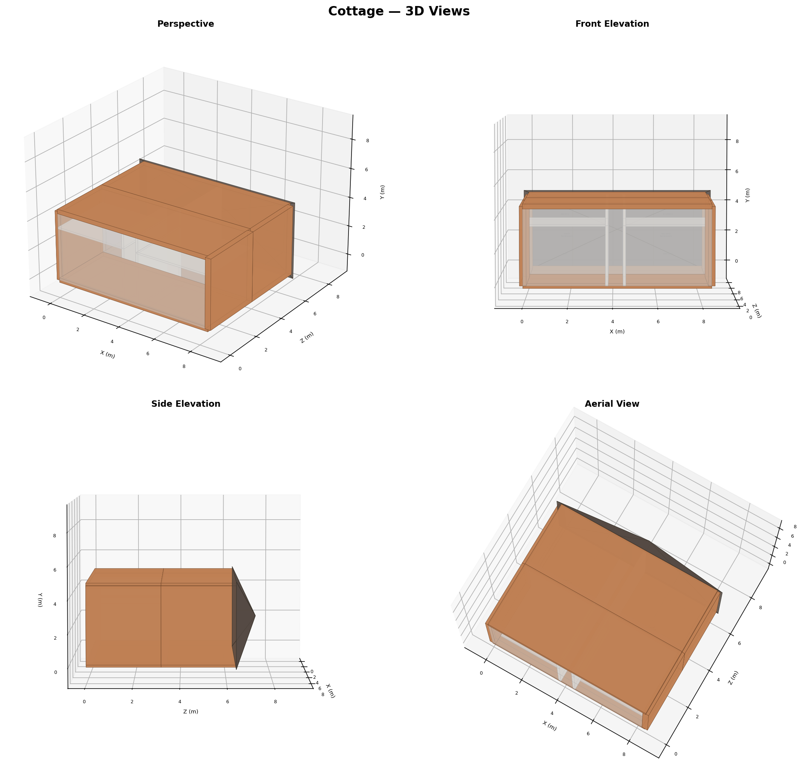

# Procedural Building Generator

A Python package that procedurally generates realistic 3D buildings with full architectural detail -- interiors, exteriors, room layouts, windows, doors, stairs, and more. Output is game-engine-compatible (glTF) for use in world-building simulations.

Buildings are generated from first principles: structural engineering, real material properties, and period-correct construction methods down to the individual brick.



## Features

- **4-stage generation pipeline**: building program, floor plan layout, 3D geometry, style application
- **Granular construction detail**: individual bricks (Flemish/English/stretcher bond), cavity walls, sash windows with glazing bars, panel doors, slate roof tiles
- **Structural engineering**: real load calculations, span tables, foundation sizing from material science data
- **Building systems**: plumbing (soil stacks, waste pipes, traps), heating (boiler, radiators, flow/return), guttering (cast iron, downpipes, hopper heads)
- **Multiple building types**: Georgian townhouse, Victorian terrace, English cottage, medieval tavern, and more
- **Deterministic**: seeded RNG ensures the same inputs always produce the same building
- **82,000+ elements** per townhouse, structurally validated with zero failures

## Example Output

### Georgian Grosvenor Townhouse (5 floors incl. basement)



### Georgian Townhouse Reference (3 floors)



### Victorian Terrace (3 floors)



### English Cottage (2 floors)



### Medieval Tavern (2 floors)



## Engineering Detail

The generator models buildings at the level of individual construction elements.

### Front Elevation -- Individual Brick Detail



### Cross Section -- Structural Elements



### Building Systems Breakdown

Each building is composed of discrete systems that can be toggled independently in the interactive 3D viewer:



### 3D Views



## Quick Start

```bash
# Install
pip install -e ".[dev]"

# Generate a Georgian townhouse
buildgen --type townhouse --style georgian --seed 42 --output output/

# Generate a cottage
buildgen --type cottage --style georgian --seed 42 --output output/

# Generate multiple buildings
buildgen --type tavern --style georgian --seed 1 --count 5 --output output/

# List available building types and styles
buildgen --list-types
buildgen --list-styles
```

## Pipeline Architecture

```
(type, era, region, size)
        |
        v
+---------------------------+
| 1. Building Program       |  Room adjacency graph with
|    Generator               |  size/function constraints
+---------------------------+
        |
        v
+---------------------------+
| 2. Floor Plan Layout      |  2D floor plans with walls,
|    Engine                  |  doors, windows
+---------------------------+
        |
        v
+---------------------------+
| 3. 3D Geometry            |  Extruded plans with roofs,
|    Generator               |  stairs, facade details
+---------------------------+
        |
        v
+---------------------------+
| 4. Style & Detail         |  Era/region-specific materials,
|    System                  |  proportions, ornament
+---------------------------+
        |
        v
    .glb file
```

## Tech Stack

| Library | Purpose |
|---------|---------|
| Shapely | 2D polygon geometry (floor plans, footprints) |
| trimesh | 3D mesh construction and glTF export |
| NetworkX | Room adjacency graphs |
| NumPy | Geometric transforms, arrays |
| Matplotlib | Floor plan rendering, diagnostic views |
| PyYAML | Building type templates, style definitions |
| Pillow | Image composition for output sheets |

## Project Structure

```
src/buildgen/
  pipeline.py          # End-to-end generation pipeline
  cli.py               # Command-line interface
  program/             # Stage 1: Building program generator
  layout/              # Stage 2: Floor plan layout engine
  geometry/            # Stage 3: 3D geometry generator
  style/               # Stage 4: Style & detail system
  engineering/         # Structural engineering & granular detail
  components/          # Component catalogue (80+ elements)
  viz/                 # Visualization & rendering
  utils/               # Shared utilities
```

## Current Statistics

| Metric | Value |
|--------|-------|
| Elements per townhouse | 82,470 |
| Total building weight | 302.5 tonnes |
| Structural failures | 0 |
| Toggleable 3D viewer groups | 22 |
| Source files | 47 |
| Lines of code | ~12,000 |
| Building type templates | 29 researched, 4 implemented |
| Material database | 20 materials with real properties |

## Requirements

- Python 3.9+
- See `pyproject.toml` for full dependency list

## License

See project files for license information.
